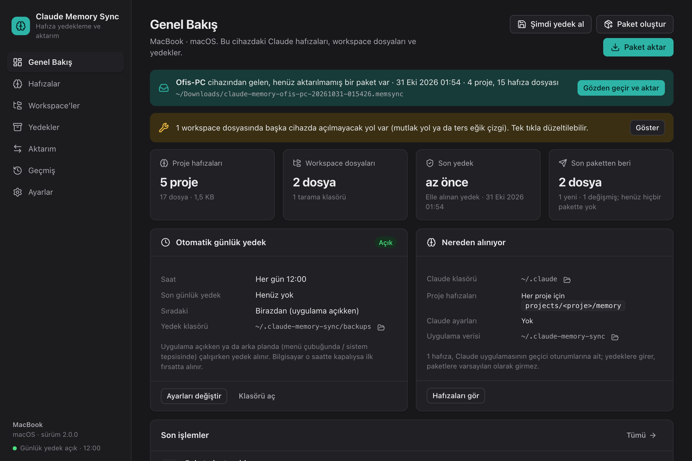
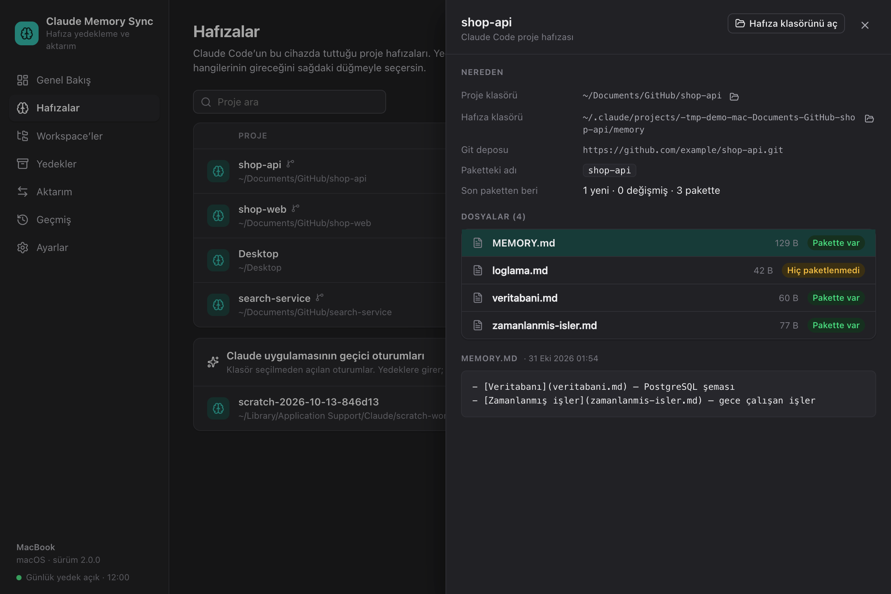
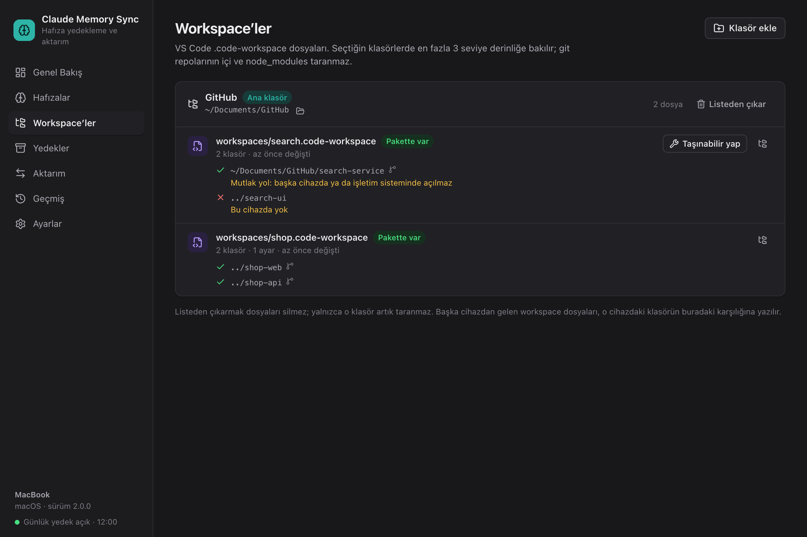
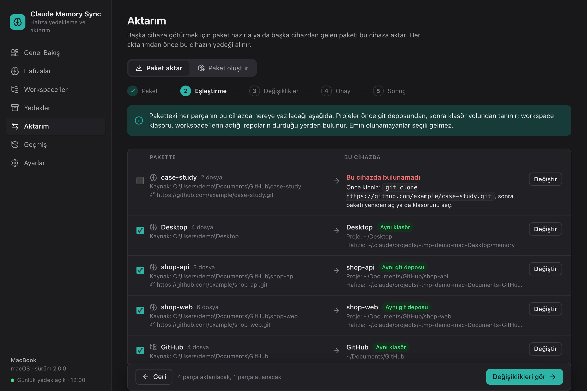
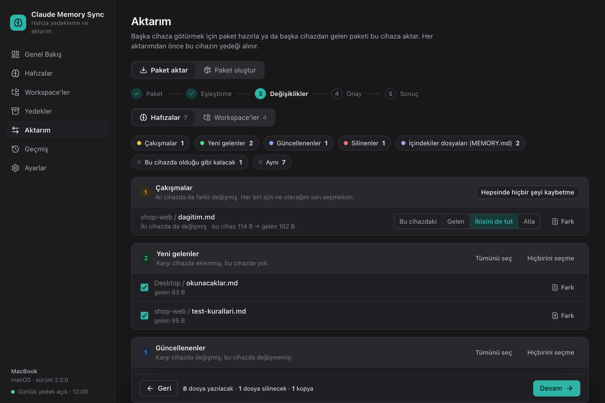
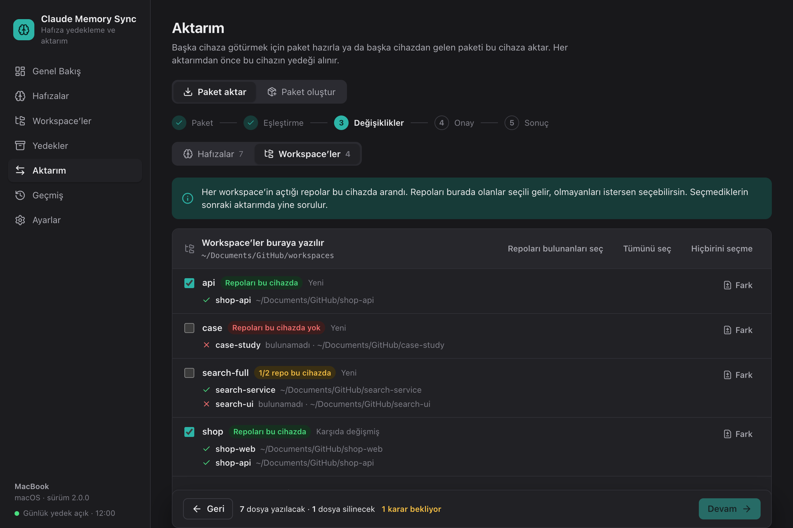
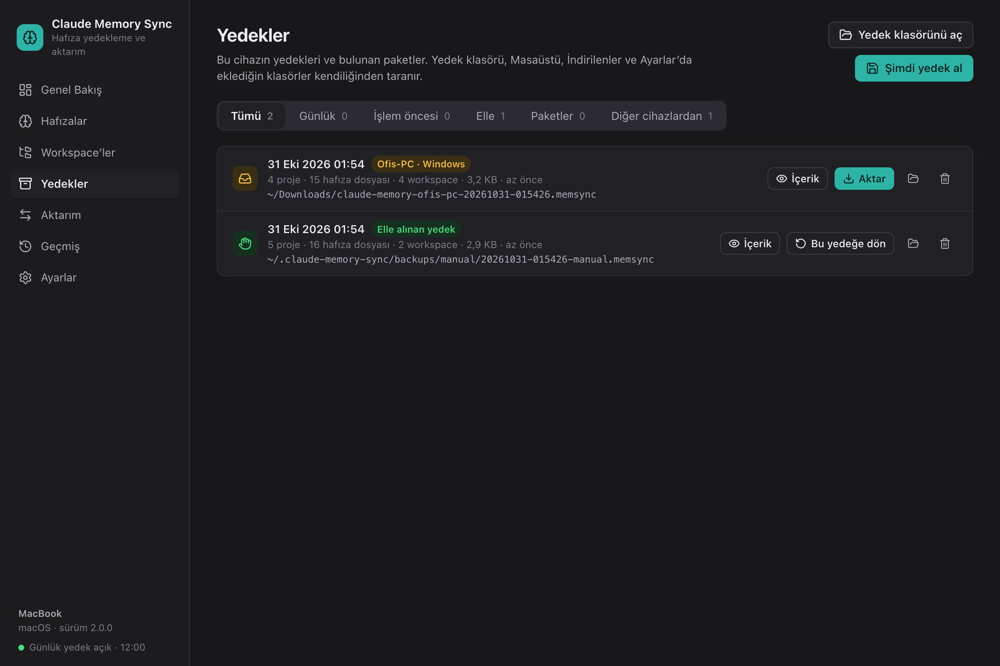
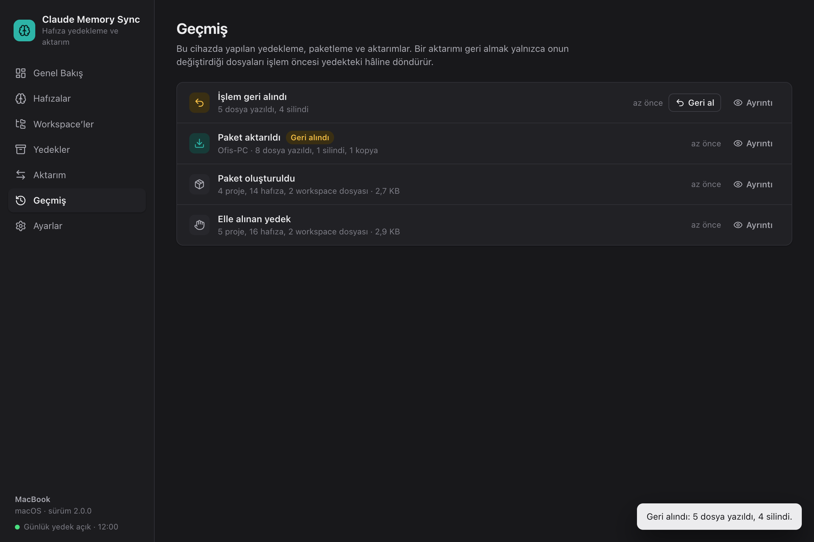

<div align="center">


# Claude Memory Sync

Back up, move and two-way sync Claude Code memories, VS Code workspaces and Claude settings between macOS and Windows.


[Features](#features) · [Screenshots](#screenshots) · [Install](#install) · [Usage](#usage) · [How it works](#how-it-works) · [Command line](#command-line) · [Development](#development)

</div>

<br>



## Why

Claude Code keeps what it learns about a project as memory files under `~/.claude/projects/<project>/memory` on the
machine it runs on. The folder name is derived from the project's absolute path, so copying it to a machine where the
project lives elsewhere does not work. Claude Memory Sync matches memories to projects on each device, shows every
change before writing it, and backs up the device before every write.

## Features

- **Everything on the device in one place.** Every Claude project, memory file and workspace, where each one comes
  from, and whether it is in the last bundle.
- **One-file transfer.** Selected items are packed into a `.memsync` bundle. Double-clicking it on the other device
  opens the import.
- **Automatic project matching.** By git remote first, then by the path relative to the home folder. Uncertain matches
  are offered but not preselected.
- **Two-way, versioned sync.** New, updated, deleted and conflicting files are listed separately. A conflict is resolved
  per file: keep this device's version, take the incoming one, or keep both. `MEMORY.md` is merged line by line.
- **Workspace-aware.** Each incoming workspace is checked against the repositories it opens. A workspace whose
  repositories are not on the device is not preselected.
- **Backup before every write,** even when a recent backup exists. Any import can be undone in one click.
- **Daily backups** from the menu bar (macOS) or the system tray (Windows).
- **Command line** built on the same core as the app.

The interface is in Turkish.

## Screenshots

### Memories

Every Claude project on the device with its project folder, memory folder, git remote and files. Projects are included
in or excluded from bundles here.



### Workspaces

`.code-workspace` files in the scanned folders and the folders they open. Paths that will not open on another device
(absolute paths, backslashes) are flagged and can be fixed in one click.



### Import

An incoming bundle is imported in five steps: bundle, matching, changes, confirmation, result.

**Matching** shows where each part of the bundle goes on this device. A project that is not on the device shows the
`git clone` command to run.



**Changes** lists only the files that differ, grouped by kind. Each file can be diffed or left out; a change that is left
out is offered again in the next import.



The **Workspaces** tab lists each workspace with the repositories it opens. Workspaces whose repositories are all on
the device are preselected.



### Backups and history

<table>
  <tr>
    <td width="50%"></td>
    <td width="50%"></td>
  </tr>
  <tr>
    <td>Daily, pre-operation and manual backups, and bundles from other devices. Any of them can be inspected or restored.</td>
    <td>Every operation. Undoing an import restores only the files it changed, from the backup taken right before it.</td>
  </tr>
</table>

## Install

There is no prebuilt release yet. The app builds from source with a double-click; the only requirement is
[Node.js](https://nodejs.org) 22.12 or later. Build tools are installed into the project folder, not system-wide.

1. Clone the repository:
   ```
   git clone https://github.com/omersahin00/claude-memory-sync.git
   ```
2. Double-click the build script. It pulls the latest code, builds the installers and opens `release/`.

   | OS | Script | Output in `release/` |
   |---|---|---|
   | macOS | `build-mac.command` | `Claude Memory Sync-<version>-arm64.dmg` (Apple Silicon), `…-x64.dmg` (Intel) |
   | Windows | `build-win.cmd` | `Claude Memory Sync Setup <version>.exe` |

3. On macOS, open the dmg and drag the app to Applications. On Windows, run the installer.

Builds are not code-signed. A copy downloaded from elsewhere may be blocked on first launch: on macOS, right-click the
app and choose Open (or System Settings → Privacy & Security → Open Anyway); on Windows, choose More info → Run anyway
in the SmartScreen dialog.

## Usage

Interface labels are given in Turkish, with the English meaning in parentheses.

**Move to a new device.** On the old device, choose **Aktarım → Paket oluştur** (Transfer → Create bundle). Copy the
bundle, saved to the Desktop by default, to the new device and double-click it. Projects are found by git remote or
path. If a project folder exists but Claude Code has never opened it, its memory folder is created.

**Sync again.** After working on both devices, open a new bundle. Only the changes are shown, and conflicts require a
decision.

**Reinstall.** Create a bundle and keep it off the device. After reinstalling, open it and choose
**Bu cihazı paketteki hâline getir** (Restore this device from the bundle).

**Undo.** **Geçmiş** (History) lists every import with a **Geri al** (Undo) button.

## How it works

### What is included

| Category | Source |
|---|---|
| Project memories | `~/.claude/projects/<project>/memory/**` |
| Workspace files | `*.code-workspace` under the scanned folders, up to 3 levels deep, not inside git repositories |
| Claude settings | `~/.claude/CLAUDE.md`, `agents/`, `commands/`, `skills/` (except `skills/synced`), `output-styles/` |

Backups contain everything; bundles contain what you select. Sessions of the Claude desktop app that have no project
folder (`scratch-workspaces`) are backed up but left out of bundles by default. `CLAUDE_CONFIG_DIR` is respected.

### Matching

Claude Code names a project's folder after the project's absolute path, so the same project has a different folder name
on each device. An incoming project is matched in this order: a match confirmed earlier, the same git remote, the same
path relative to the home folder (`Documents/GitHub/x`), an existing folder that Claude Code has not opened yet. A
project that matches only by name is suggested but not preselected. The workspace folder is the one that holds the
repositories the incoming workspaces open. Confirmed matches are remembered.

### Versioning

Each device records the hash of every version it has seen of every file and includes these hashes in bundles. This is
how a file deleted on the other device is told apart from a file added on this one.

| Situation | Group | Default |
|---|---|---|
| Added on the other device | New | Take |
| Added on the other device; a workspace whose repositories are not here | New | Skip, offered again next time |
| Changed on the other device only | Updated | Take |
| Deleted on the other device, unchanged here | Deleted | Delete |
| Changed on both devices | Conflict | Decision required |
| Changed here and deleted there, or the reverse | Conflict | Decision required |
| Added, changed or deleted only here | Kept | Untouched |
| `MEMORY.md` | Merge | Merged line by line; a line that differs is asked |

### Safety

- Before every import, restore, undo and workspace fix, a full backup of the device is written and verified by reading
  it back, even if a backup was just taken.
- If a file changes after the plan was made (for example, Claude wrote to it meanwhile), nothing is written and the plan
  is rebuilt.
- Each file is written to a temporary file and moved into place. If a write fails, everything written so far is rolled
  back.
- Every written file is read back and checked. Version history is updated only after that.
- Bundle contents are verified against their hashes; a damaged bundle is rejected.
- Line ending (CRLF/LF) and BOM differences do not count as changes.
- A memory folder that suddenly looks empty is left out of bundles, so it cannot turn into a mass delete on the other
  device.
- Invalid Windows file names and names that differ only by case are rejected before anything is written.
- The window can call only an allow-listed set of core functions. The app makes no network requests.

### Files

| What | Where |
|---|---|
| Settings, version history, activity log | `~/.claude-memory-sync/` (`config.json`, `history.json`, `state.json`, `activity.jsonl`) |
| Backups | `~/.claude-memory-sync/backups/{daily,before,manual}` (configurable) |
| Bundles | Desktop by default: `claude-memory-<device>-<date>.memsync` |

A `.memsync` file is gzipped JSON and is opened with the app.

## Command line

```
node cli.js status              # what is on this device (read-only)
node cli.js backup [-o folder]  # create a bundle for another device
node cli.js sync <bundle>       # two-way merge with a bundle
node cli.js restore <bundle>    # make this device match a bundle
node cli.js config              # device name and workspace folders
```

## Development

```
npm install
npm run dev          # development mode (Vite + Electron)
npm test             # tests
npm run dist:mac     # macOS installers into release/
npm run dist:win     # Windows installer into release/
```

`release/` holds only installers; intermediate build output stays in `dist/electron`. The screenshots on this page are
rendered from two sample devices, without real data:

```
CMS_SCALE=2 node scripts/screenshots.mjs <folder> dark
```

| Path | Contents |
|---|---|
| `lib/` | Core. `engine.js` is the single entry point for both the app and the command line |
| `app/` | Electron main process, preload script and the React interface (`app/renderer`) |
| `cli.js`, `lib/commands/` | Command line |
| `scripts/` | Development, packaging and screenshot helpers |
| `test/` | Tests (`node:test`) |
| `docs/` | [Design notes](docs/TASARIM.md) (in Turkish) and screenshots |

## Migrating from 1.x

On first launch the 1.x `config.json` (`reposRoot`, `prefix`) is converted, and the old files are kept as
`config.v1.json` and `history.v1.json`. Bundles from 1.x can be imported, but 1.x cannot read new bundles, so update
both devices. The 1.x prefix filter is gone: every project is listed, and you choose what goes into a bundle.
