<div align="center">

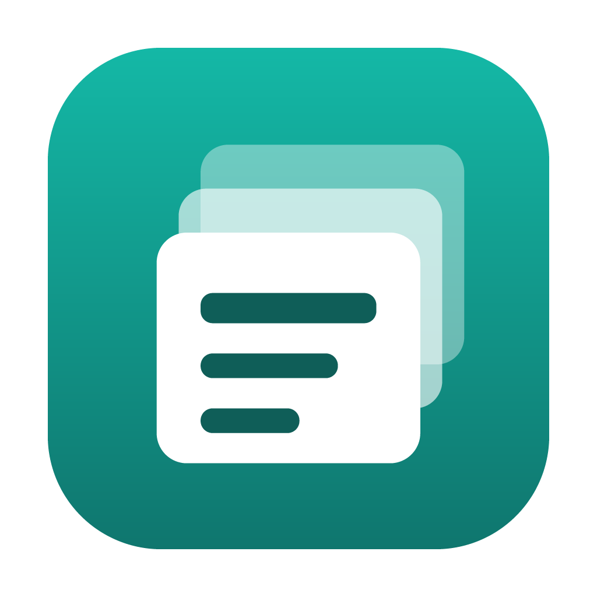

# Claude Memory Sync

Back up, move and two-way sync Claude Code memories and chats, VS Code workspaces and Claude settings between macOS and
Windows.


[](LICENSE)

[Features](#features) · [Screenshots](#screenshots) · [Install](#install) · [Usage](#usage) · [How it works](#how-it-works) · [Command line](#command-line) · [Development](#development) · [License](#license)

</div>

<br>

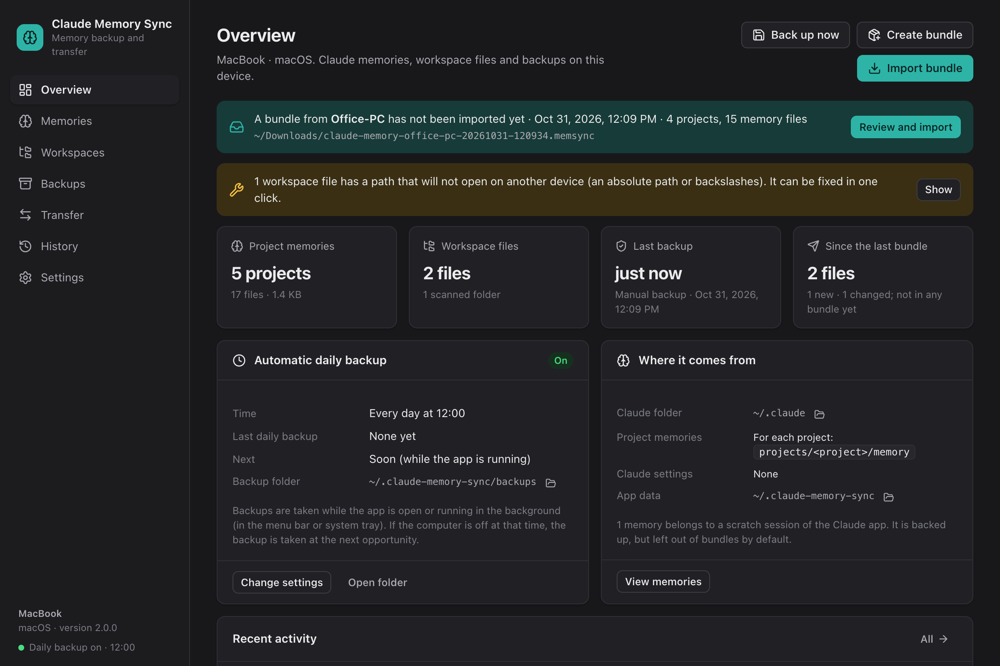

## Why

Claude Code keeps what it learns about a project as memory files under `~/.claude/projects/<project>/memory` on the
machine it runs on. The folder name is derived from the project's absolute path, so copying it to a machine where the
project lives elsewhere does not work. Claude Memory Sync matches memories to projects on each device, shows every
change before writing it, and backs up the device before every write.

## Features

- **Everything on the device in one place.** Every Claude project, memory file and workspace, where each one comes
  from, and whether it is in the last bundle.
- **One-file transfer.** Selected items are packed into a `.memsync` bundle. Double-clicking it on the other device
  opens the import.
- **Automatic project matching.** By git remote first, then by the path relative to the home folder. Uncertain matches
  are offered but not preselected.
- **Two-way, versioned sync.** New, updated, deleted and conflicting files are listed separately. A conflict is resolved
  per file: keep this device's version, take the incoming one, or keep both. `MEMORY.md` is merged line by line.
- **Workspace-aware.** Workspace files can be picked one by one for a bundle. Each incoming workspace is checked
  against the repositories it opens; a workspace whose repositories are not on the device is not preselected.
- **Claude Code chats,** optionally, with everything that belongs to them: sub-agent conversations, large tool outputs,
  file history, added files, typed prompts and the desktop app's record. They can be picked by the groups of the Claude
  desktop app's sidebar and land in the same group. No chat on the receiving device is deleted or shortened; a chat
  continued on both devices arrives as a separate copy.
- **Encrypted, incremental backups.** Every backup goes into one encrypted backup folder that only your password and a
  recovery code open, and stores only what changed since the one before. Old backups are thinned out like Time
  Machine. The engine is [restic](https://restic.net), shared with
  [Folder Backup](https://github.com/omersahin00/folder-backup).
- **Backup before every write,** even when a recent backup exists. Any import can be undone in one click.
- **Scheduled backups** every hour, day or week, from the menu bar (macOS) or the system tray (Windows), with contents
  you choose: projects, workspace files and Claude settings one by one, and optionally chats (all of them, those of
  chosen projects or Claude desktop groups, or single chats). A chat takes room again only for what was added to it.
- **Full backup before a reset.** Memories, chats, workspace files and Claude settings, plus the app's own settings,
  version history and activity log, in one file whose size is shown before it is written. Restoring it brings
  everything back where it was, also under a different user name.
- **With Folder Backup.** When both apps are on one computer, each shows the other's backups; Folder Backup can back up
  the Claude backups now and change when they run and what they take. Only this app backs them up.
- **The window stays responsive.** Backups run in restic's own processes, bundles in a separate process, with a progress
  bar and a **Cancel** button that stops only that job. The free space on the disk is checked before anything is
  written.
- **Command line** built on the same core as the app.
- **English, Turkish, German, Spanish and French,** light and dark, error messages included. The app follows the system
  language and appearance; both can be changed in Settings.

## Screenshots

### Memories

Every Claude project on the device with its project folder, memory folder, git remote and files. Projects are included
in or excluded from bundles here.

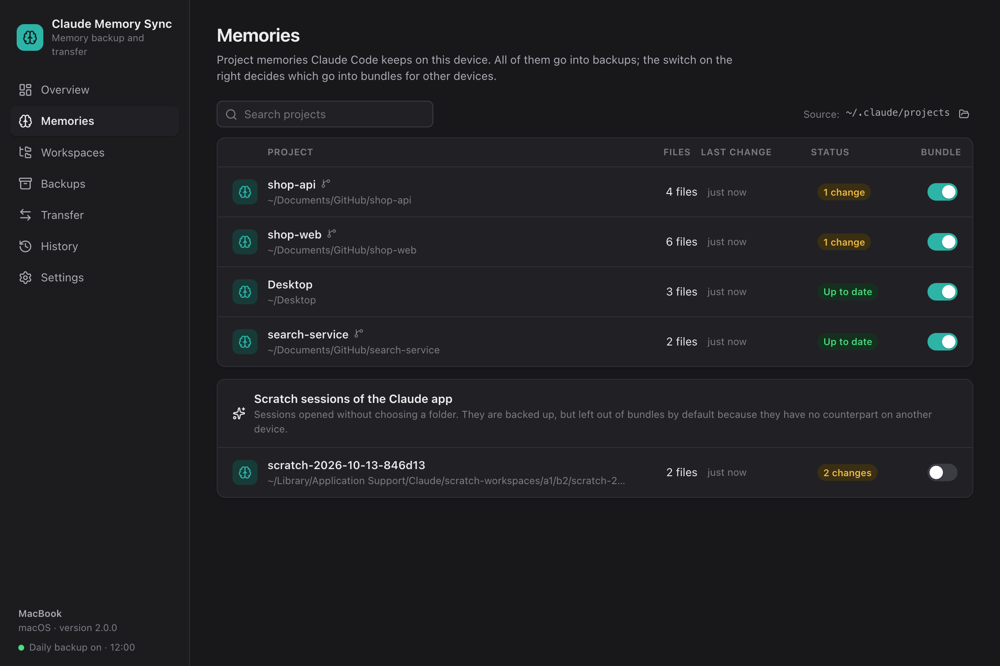

### Workspaces

`.code-workspace` files in the scanned folders and the folders they open. Paths that will not open on another device
(absolute paths, backslashes) are flagged and can be fixed in one click.

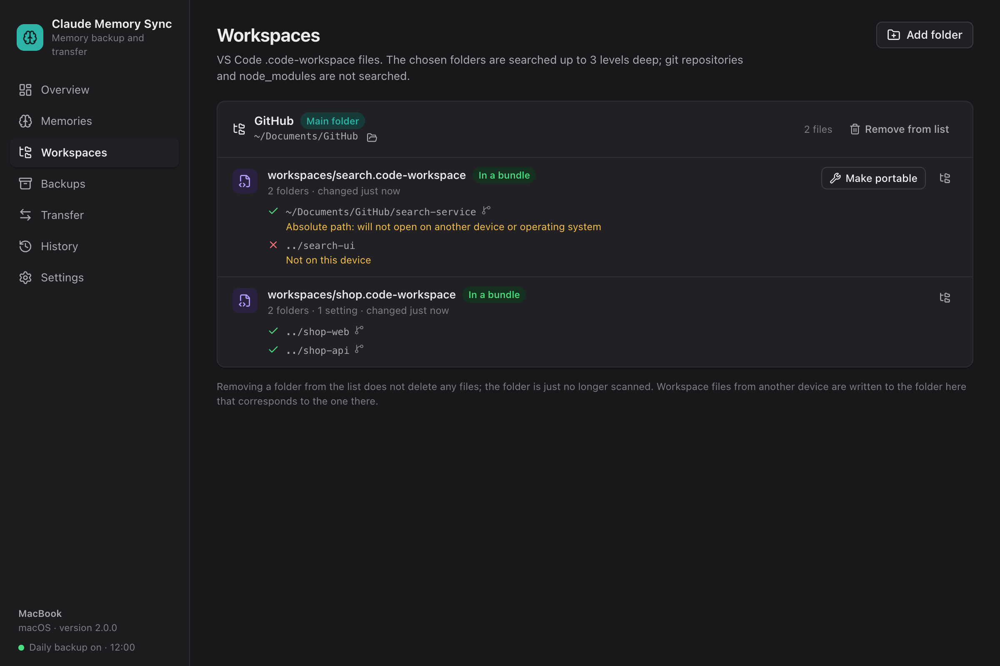

### Create bundle

Every project is listed with its memory and its chats; a click on a project shows its chats. A group of the Claude
desktop app's sidebar takes all of its chats and their projects' memory. A chat always goes with its project's memory.

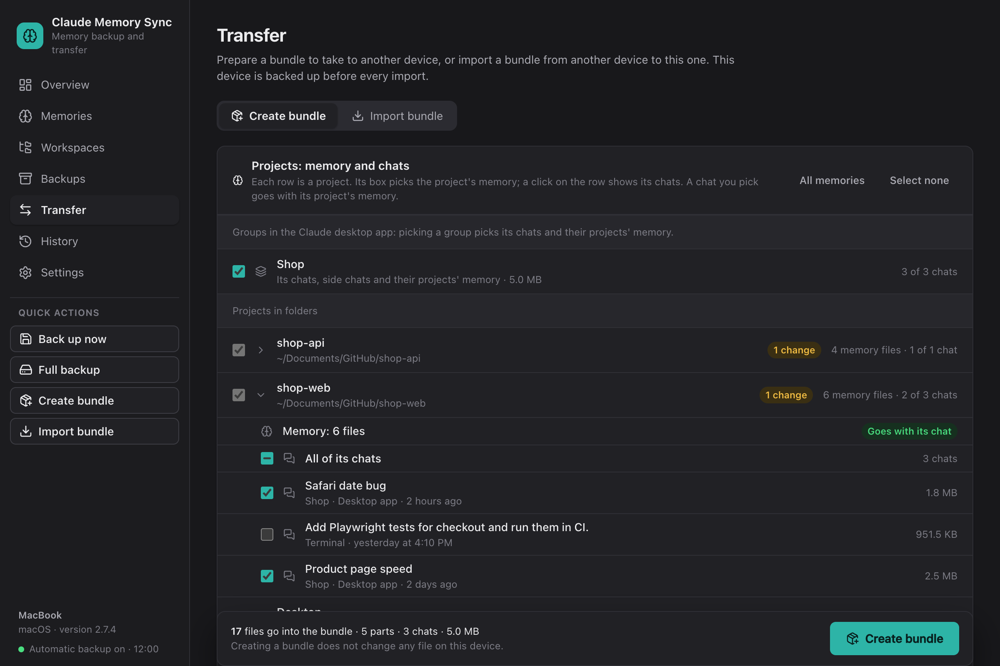

### Import

An incoming bundle is imported in five steps: bundle, matching, changes, confirmation, result.

**Matching** shows where each part of the bundle goes on this device. A project that is not on the device shows the
`git clone` command to run.

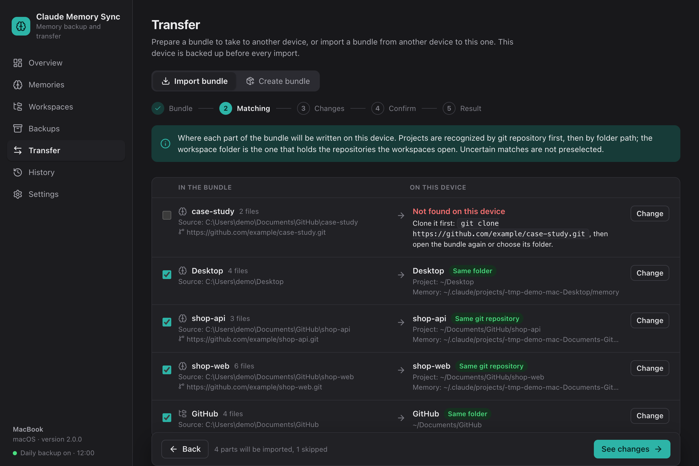

**Changes** lists only the files that differ, grouped by kind. Each file can be diffed or left out; a change that is left
out is offered again in the next import.

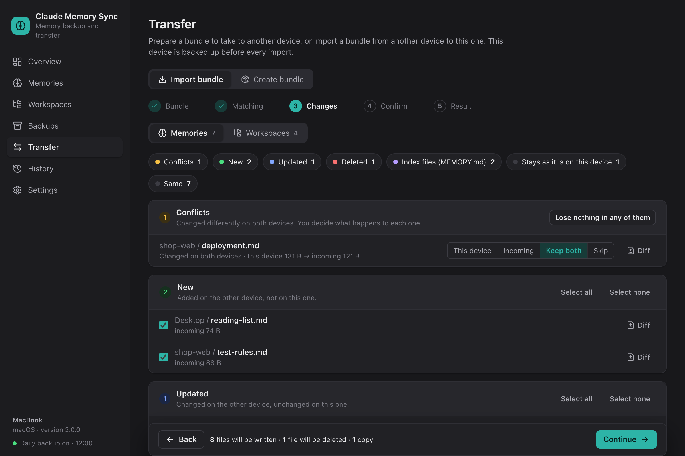

The **Workspaces** tab lists each workspace with the repositories it opens. Workspaces whose repositories are all on
the device are preselected.

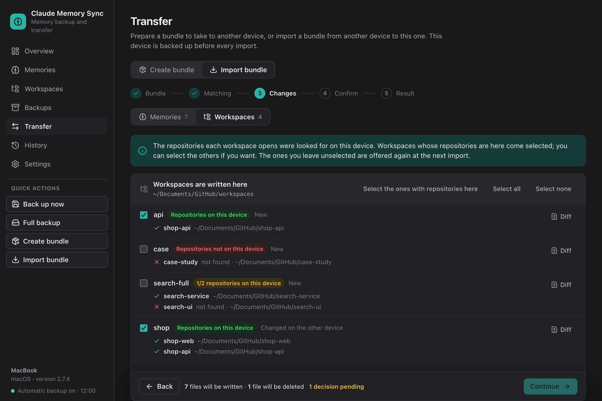

### Backups and history

<table>
  <tr>
    <td width="50%">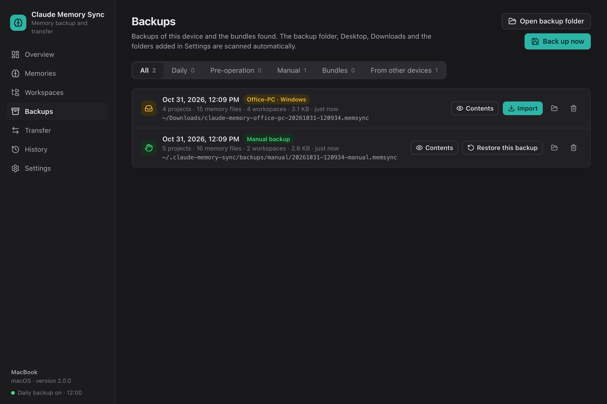</td>
    <td width="50%">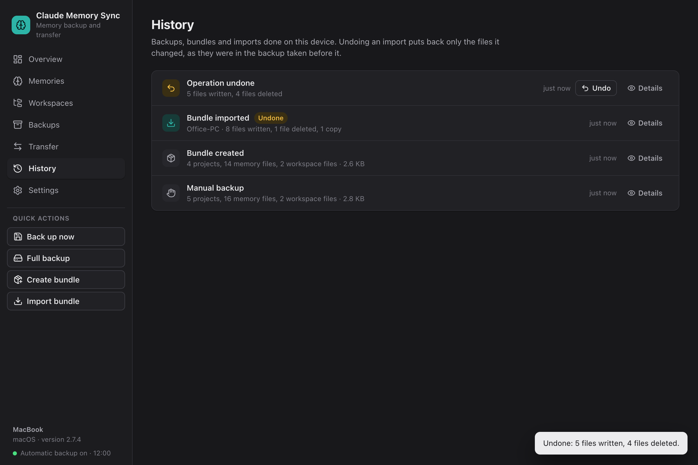</td>
  </tr>
  <tr>
    <td>The encrypted backups of this device, with those taken before each operation, and the bundles and full backups found. Any of them can be inspected or restored.</td>
    <td>Every operation. Undoing an import restores only the files it changed, from the backup taken right before it.</td>
  </tr>
</table>

### Full backup

**Full backup** in the sidebar shows what goes in, the expected size of the file and the free space on the disk before
anything is written.

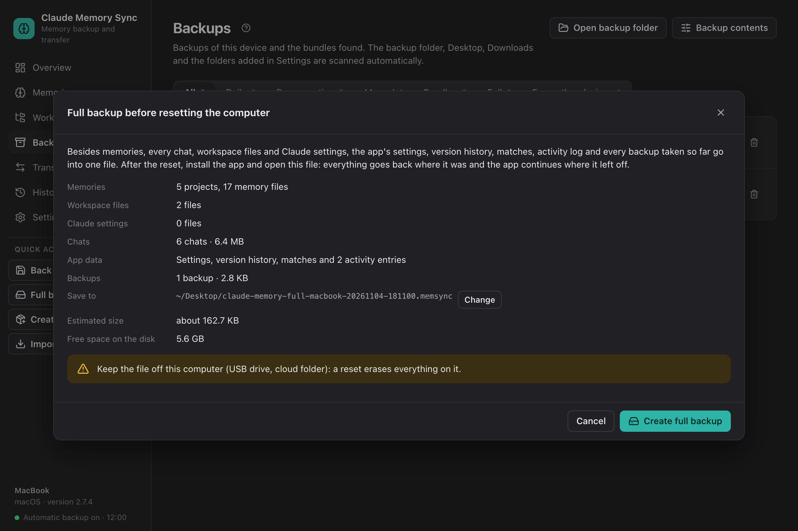

## Install

Download the installer for your system from the [latest release](https://github.com/omersahin00/claude-memory-sync/releases/latest):

| System | Installer |
|---|---|
| **macOS** · Apple Silicon (M1 or later) | `Claude-Memory-Sync-macOS-Apple-Silicon-<version>.dmg` |
| **macOS** · Intel | `Claude-Memory-Sync-macOS-Intel-<version>.dmg` |
| **Windows** · 64-bit | `Claude-Memory-Sync-Windows-Setup-<version>.exe` |

Not sure which Mac you have? In the Apple menu, choose About This Mac: "Chip: Apple M…" is Apple Silicon,
"Processor: Intel" is Intel.

On macOS, open the dmg and drag the app to Applications. On Windows, run the installer.

The installers are not code-signed. On macOS, the first launch has to be allowed in System Settings → Privacy &
Security → Open Anyway. On Windows, choose More info → Run anyway in the SmartScreen dialog.

On macOS the app first explains what it reads, then lets macOS ask for access to three folders: Desktop (bundles and
full backups are saved there by default), Documents (workspace files, and the git remotes that match projects to the
other device) and Downloads (downloaded bundles). Without them, memories, chats and Claude settings still work, since
they live in the Claude folder; workspace files and bundles in a folder without access are not seen, and projects
there are not matched on their own. As the builds are not signed, macOS asks again after each update. Access can be
changed later in System Settings → Privacy & Security → Files and Folders.

### Build from source

The only requirement is [Node.js](https://nodejs.org) 22.12 or later; build tools are installed into the project
folder, not system-wide. Clone the repository and double-click the build script for your system, `build-mac.command`
or `build-win.cmd`. It pulls the latest code, builds the installers into `release/` and opens that folder.

```
git clone https://github.com/omersahin00/claude-memory-sync.git
```

## Usage

**The main actions stay in one place.** **Back up now**, **Full backup**, **Create bundle** and **Import bundle** are
under **Quick actions** in the sidebar, on every screen.

**Move to a new device.** On the old device, choose **Create bundle**. Copy the bundle, saved to the Desktop
by default, to the new device and double-click it. Projects are found by git remote or path. If a project folder exists
but Claude Code has never opened it, its memory folder is created.

**Sync again.** After working on both devices, open a new bundle. Only the changes are shown, and conflicts require a
decision.

**Take chats along.** In **Create bundle**, every project is listed with its memory and its chats: a project's box
takes its memory, and a click on the project shows its chats to tick. A chat always goes with its project's memory, so
the project stays ticked while one of its chats is. The groups of the Claude desktop app's sidebar are listed above the
projects: ticking one takes all of its chats, with their side chats and earlier parts, and their projects' memory.
Sessions opened in the desktop app without a folder are listed below the projects by their titles there. On the other
device the chats are listed in the **Chats** tab of the import, and the desktop app's sessions go back into their groups
there. Bundles with chats need version 2.4 or later on both devices.

**Set up backups.** A new install asks once: choose a folder (best on another disk) and a password. The backup folder
is `<folder>/Claude Memory Sync/Claude`. A recovery code is shown once; keep it somewhere safe, since it opens the
backups when the password is forgotten, also on another computer. Until backups are set up, nothing is imported,
restored or undone, because every change is backed up first. Backups of versions before 3.0 (`.memsync` files) are
not used any more; **Backups** says where they are, and they can still be opened as bundles.

**Reset or reinstall.** Keep the backup folder on another disk, and choose **Full backup** too, keeping the file off the
computer. After the reset, install the app and double-click the file: memories, chats, workspace files and Claude
settings go back where they were, the app's settings, version history, matches and activity log come back, and the app
continues where it left off. Then **Backups → Open an existing backup** opens the backup folder with its password or
recovery code, and backing up goes on in it. A different user name on the new install is fine: paths move to the new
home folder. On another operating system, a full backup is offered as a bundle to import: memories, chats, workspace
files and Claude settings come over, the app's own data does not.

**Cancel a backup.** While a backup, full backup or bundle is being written, the window shows its progress and cannot
be used. **Cancel** stops only that job; earlier backups are not touched and nothing half-written is kept.

**When backups are taken.** **Backups → Schedule** and **Settings → Backups**: every hour, day or week at a time, or by
hand only. A backup missed while the computer was off or asleep is taken when it is back. Backups before imports,
restores and undo are taken either way, and **Back up now** works at any time.

**Choose what backups take.** In **Settings → Backup contents** (also on **Backups**), untick projects, workspace
files or Claude settings, and choose which chats go in. This applies to scheduled backups and **Back up now**; the
backup taken before every import always holds every memory, workspace file and Claude setting.

**How many backups stay.** Every backup of the last 24 hours, one a day for 30 days and one a week after that; of the
backups taken before an operation, the newest 50 (the number is in **Settings → Backups**).

**Check and repair.** After a backup, a twelfth of the backup folder is read back about once a day; **Check all** reads
all of it, and **Repair** fixes damage in restic's documented order.

**Undo.** **History** lists every import with an **Undo** button.

## How it works

### What is included

| Category | Source |
|---|---|
| Project memories | `~/.claude/projects/<project>/memory/**` |
| Workspace files | `*.code-workspace` under the scanned folders, up to 3 levels deep, not inside git repositories |
| Claude settings | `~/.claude/CLAUDE.md`, `agents/`, `commands/`, `skills/` (except `skills/synced`), `output-styles/` |
| Chats (when selected) | `~/.claude/projects/<project>/<id>.jsonl` and `<id>/`, `~/.claude/file-history/<id>/`, `~/.claude/uploads/<id>/`, the chat's lines in `~/.claude/history.jsonl`, the desktop app's `claude-code-sessions` record |

Scheduled and manual backups take what **Backup contents** leaves in: by default every memory, workspace file and
Claude setting, and no chats. Memories and workspace files are left out by name, so new projects and files go in on their
own. Pre-operation backups always take every memory, workspace file and Claude setting, since undo and rollback rely on
them; full backups take everything, chats included. Bundles contain what you select, and a chat always takes its
project's memory along, in bundles and in backups. Sessions of the Claude desktop app that have no project folder
(`scratch-workspaces`) are shown by their titles in the app and are backed up; in a bundle their memory goes when
ticked or with their chats, and on the other device they go to the same scratch folder of the Claude app.
`CLAUDE_CONFIG_DIR` is respected.

### Matching

Claude Code names a project's folder after the project's absolute path, so the same project has a different folder name
on each device. An incoming project is matched in this order: a match confirmed earlier, the same git remote, the same
path relative to the home folder (`Documents/GitHub/x`), an existing folder that Claude Code has not opened yet. A
project that matches only by name is suggested but not preselected. The workspace folder is the one that holds the
repositories the incoming workspaces open. Confirmed matches are remembered.

A Desktop, Documents or Pictures folder that Windows keeps in OneDrive counts as the same place as the other device's.
Folder names with letters such as ş or ü match whichever form each disk stores them in (macOS can keep them
decomposed), and a new Claude project folder gets the name Claude Code gives it: the path in NFC form, cut at 200
characters with a hash.

### Versioning

Each device records the hash of every version it has seen of every file and includes these hashes in bundles. This is
how a file deleted on the other device is told apart from a file added on this one.

| Situation | Group | Default |
|---|---|---|
| Added on the other device | New | Take |
| Added on the other device; a workspace whose repositories are not here | New | Skip, offered again next time |
| Changed on the other device only | Updated | Take |
| Deleted on the other device, unchanged here | Deleted | Delete |
| Changed on both devices | Conflict | Decision required |
| Changed here and deleted there, or the reverse | Conflict | Decision required |
| Added, changed or deleted only here | Kept | Untouched |
| A workspace file the other device left out of the bundle | (not listed) | Untouched, also in a restore |
| `MEMORY.md` | Merge | Merged line by line; a line that differs is asked |

### Chats

A chat goes to its project's Claude folder on the receiving device; its prompt history and the desktop app's record are
pointed at the project folder there. The desktop app's record is written when the app is installed on that device, also
when it has not run a Code session there yet (for example, when it was used only through Remote Control), and the app
lists the chat when it is signed in to the same account. A chat that came over earlier without its record gets it when
the bundle is opened again. A session of the desktop app that had no folder goes to the same scratch folder of the app
there, which is made for it.

A session in a group of the desktop app's sidebar goes into the group of the same name there; a group that is not there
yet is added. The groups are kept in the app's settings file (`claude_desktop_config.json`), which the app writes over
while it runs, so they are set up only while the Claude app is closed, after a copy of the file is kept in this app's
folder (`claude-desktop/`, the last ten). If Claude is running, the chats come anyway; opening the bundle again with
Claude closed sets up only the groups. A session already in a group on that device stays where it is.

| Situation | Result |
|---|---|
| Not on this device | Added |
| Continued on the other device (this device has its beginning), or some of its files are missing here | Brought up to date |
| The same on both devices | Untouched |
| Further along on this device | Untouched |
| Continued on both devices | Added next to this device's chat under a new id; its title names the other device |

Chats go into backups only when chosen in **Backup contents**, and restoring such a backup brings them back by the same
rules. A chat is stored once and then only what is added to it; the backup's folder on this computer links to the chat
files instead of copying them, so it takes no room. Undoing an import never touches a chat and does not remove the
chats it brought in.

### Safety

- Before every import, restore, undo and workspace fix, every memory, workspace file and Claude setting is backed up
  into the encrypted backup folder, even if a backup was just taken. If that backup cannot be taken, nothing is written.
- If a file changes after the plan was made (for example, Claude wrote to it meanwhile), nothing is written and the plan
  is rebuilt.
- Each file is written to a temporary file and moved into place. If a write fails, everything written so far is rolled
  back.
- Nothing is written unless it fits with room to spare: 2 GB stay free on the disk the computer runs from, 100 MB on
  another disk. A backup or bundle that is cancelled or fails leaves no file behind.
- Every written file is read back and checked. Version history is updated only after that.
- Bundle contents are verified against their hashes; a damaged bundle is rejected.
- Nothing in the backup folder can be read without the password or the recovery code (AES-256, with a Poly1305 code on
  every file, so any change is found). A backup stopped at any point saves nothing and leaves the earlier ones whole.
- Line ending (CRLF/LF) and BOM differences do not count as changes.
- A memory folder that suddenly looks empty is left out of bundles, so it cannot turn into a mass delete on the other
  device.
- Invalid Windows file names and names that differ only by case are rejected before anything is written.
- The window can call only an allow-listed set of core functions. The app makes no network requests and has no
  accounts, analytics or usage data; data leaves the device only in the bundles and backups you move yourself.

### Files

| What | Where |
|---|---|
| Settings, version history, activity log | `~/.claude-memory-sync/` (`config.json`, `history.json`, `state.json`, `activity.jsonl`) |
| Backups | The backup folder chosen when they are set up: `<folder>/Claude Memory Sync/Claude`, a restic repository |
| The backups' password | `~/.claude-memory-sync/secrets.json`, encrypted by the system (Keychain, DPAPI) |
| Bundles | Desktop by default: `claude-memory-<device>-<date>.memsync` |

A `.memsync` file is gzipped JSON and is opened with the app. A bundle with chats stores each file as a separately
compressed part with the index at the end, so chats of any size are read only while they are written; every part is
checked against its hash.

## Command line

```
node cli.js status              # what is on this device (read-only)
node cli.js backup [-o folder]  # create a bundle for another device
node cli.js sync <bundle>       # two-way merge with a bundle
node cli.js restore <bundle>    # make this device match a bundle
node cli.js undo                # undo the last sync or restore, from the backup taken before it
node cli.js setup-backups <dir> # set up this device's encrypted backups
node cli.js config              # device name and workspace folders
```

The command line takes the backups' password from `CLAUDE_MEMORY_SYNC_PASSWORD`; the one the app keeps is encrypted for
the app alone.

## Development

```
npm install
npm run dev          # development mode (Vite + Electron)
npm test             # tests
npm run dist:mac     # macOS installers into release/
npm run dist:win     # Windows installer into release/
```

`release/` holds only installers; intermediate build output stays in `dist/electron`. The screenshots on this page are
rendered from two sample devices, without real data; the last argument is the interface language, and
`CMS_SHOTS_HOME` (an empty or missing folder) keeps the paths in the pictures short:

```
CMS_SHOTS_HOME=/tmp/demo CMS_SCALE=2 node scripts/screenshots.mjs <folder> dark en
```

| Path | Contents |
|---|---|
| `lib/` | Core. `engine.js` is the single entry point for both the app and the command line |
| `app/` | Electron main process, preload script and the React interface (`app/renderer`) |
| `app/locales/` | Interface texts, one JSON file per language |
| `cli.js`, `lib/commands/` | Command line |
| `scripts/` | Development, packaging and screenshot helpers |
| `test/` | Tests (`node:test`) |
| `docs/` | [Design notes](docs/TASARIM.md) (in Turkish) and screenshots |

### Translations

To add a language, copy `app/locales/en.json` to a file named after the language code (`it.json`, `pt.json` …) and
translate the texts, keeping every `{placeholder}`. Texts with `one` and `other` forms follow the plural rules of the
language. The new language appears in Settings; `npm test` reports missing texts and placeholders.

### Releasing

Set the new version in `package.json`, commit, and push a matching tag:

```
git tag v2.0.1
git push origin v2.0.1
```

The [release workflow](.github/workflows/release.yml) builds the macOS and Windows installers on GitHub and publishes
them on the Releases page.

## Migrating from 1.x

On first launch the 1.x `config.json` (`reposRoot`, `prefix`) is converted, and the old files are kept as
`config.v1.json` and `history.v1.json`. Bundles from 1.x can be imported, but 1.x cannot read new bundles, so update
both devices. The 1.x prefix filter is gone: every project is listed, and you choose what goes into a bundle.

## License

[MIT](LICENSE). The app and its code may be used, copied, changed and shared, commercially too, as long as the license
notice goes with them. It comes without warranty.

The installers contain Electron, React and Lucide icons, which have their own licenses (MIT and ISC).

Claude Memory Sync is an independent project, not made or endorsed by Anthropic. Claude is a trademark of Anthropic.
